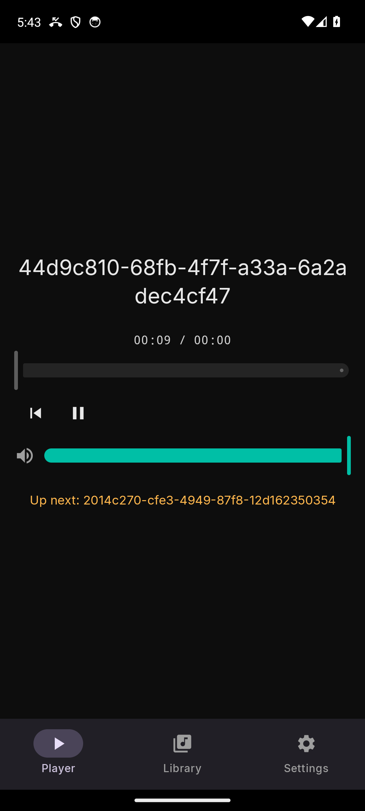

# Fauste Player Mobile — User guide

Fauste Player Mobile is a standalone local-file audio player for Android.
It is built on the same Rust audio engine as the desktop
[Fauste Player](https://github.com/sanchezfauste/fauste-player), wrapped in a
native app with playback in a foreground service. There is no account, no
streaming, no analytics: the only network the app ever opens is a loopback
(on-device) socket (see [Settings](settings.md#remote)). Your files stay on
your phone.

> **Built with AI assistance, provided as is.** Fauste Player Mobile, this
> guide included, was developed with substantial help from AI tools. It comes
> without any warranty and you use it at your own risk.

| Guide | What it covers |
|---|---|
| [Getting started](getting-started.md) | Installing, permissions, importing music, playing |
| [The queue](the-queue.md) | How the queue works: tap to arm the next track, auto-advance, what plays when |
| [Settings](settings.md) | The audio backend, the volume, the remote status |
| [Background playback](background-playback.md) | The notification, the lock screen, calls, what survives a kill |
| [Data and backups](data-and-backups.md) | What is saved and where, imported files, crash reports, uninstalling |
| [Troubleshooting](troubleshooting.md) | No sound, missing notification, failed imports, languages |

## What it does today

- Import audio files through the system file picker; the app copies them
  into its own storage and appends each to the queue.
- Play, pause, seek and set the volume from the Player screen; the queue
  plays on by itself.
- Keep playing in the background and from the lock screen, with a
  notification and media controls; a call pauses the music and a navigation
  prompt briefly lowers it.
- Survive a force-kill: the queue and the paused position come back.
- Write crash reports you can attach to a bug report.

## What it does not do yet

The queue is a flat list. There are no playlists, no drag-reordering, no
waveform, no cue points and no cartwall: those are roadmap items, not hidden
switches. Track durations read "—" until the analysis layer ships, rows (and the
Player title) show the internal name of the imported copy rather than the
original file's name, and artists are not read yet — nothing on mobile
reads the files' tags. The honest, current list is the
[feature table in the repository's README](https://github.com/sanchezfauste/fauste-player-mobile#features).

The interface is available in English (en-US) and Spanish (es-ES) and
follows the language of the device; there is no in-app switcher. The Spanish
translation, like the English copy, was produced with AI and may contain
errors. Corrections are welcome as issues or pull requests.
