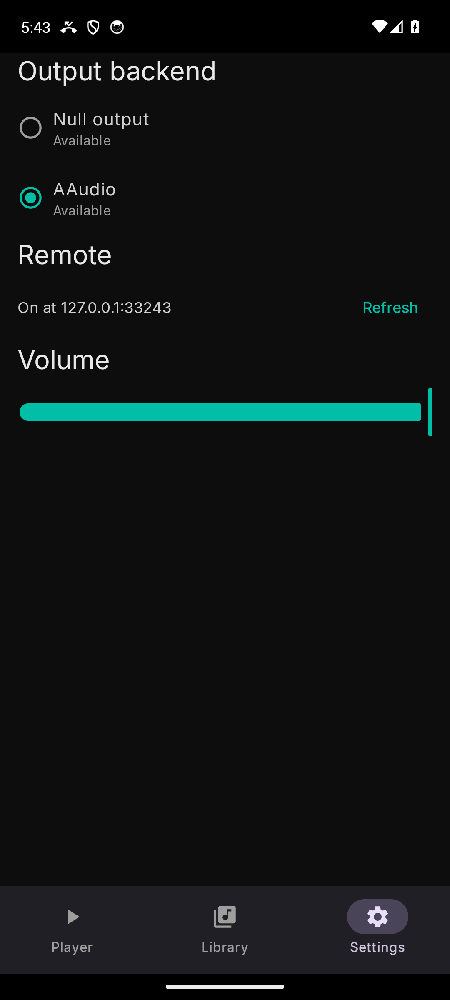

# Settings

The Settings screen has three sections; changes apply at once and are kept
across restarts.

## Output backend

The engine probes the device's audio outputs and lists one row per backend,
each with an *Available* or *Unavailable* line. Only available backends can
be selected. The picker lists the engine's Android backends:

- **AAudio** — Android's native audio API, the engine's real output path
  (the desktop speaks ALSA, PulseAudio or WASAPI; the phone speaks AAudio).
  This is what plays your music.
- **Null output** — the engine's silent fallback, the equivalent of the
  desktop's "No output (silent)": a device with no sound card, or a
  rehearsal run with nothing sent to the speakers.

The selected marker follows what the engine **actually** uses, never the
last tap: a switch that failed, or a device the engine fell back from, reads
honestly on the screen. If no backend answered the probe, the section says
so — an empty list is reported, not filled with guesses.

## Volume

The slider is the same engine volume as the Player screen's — the player's
own volume, not the system volume. The bar follows your finger instantly;
*Applying…* shows while the change is being confirmed, and disappears when
the engine answers.

## Remote

The status line of the engine's built-in HTTP remote — the same API the
desktop app and scripting clients speak, compiled into the engine. It reads
`On at 127.0.0.1:<port>` while it is serving, `Off` otherwise; **Refresh**
re-reads the status. The port is chosen by the system at each start, which
is why it is not a fixed number.

What it is **not**: a way to control the phone from other devices. The
server is pinned to loopback — reachable from the device itself only, from
another on-device app or from `adb forward` during development. There is no
pairing and no remote control from other machines, by design. The on-device
API exists for the desktop's ecosystem and for development tooling, and one
of its limits is documented under
[Background playback](background-playback.md#the-honest-limits).
