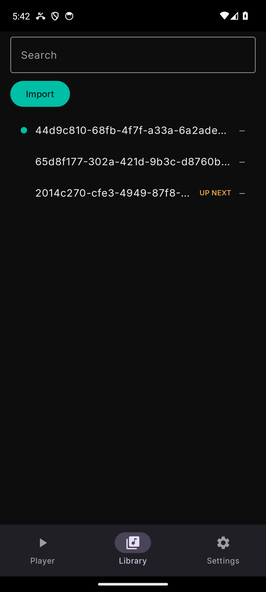

# The queue

The Library screen shows the queue. Imports append to its end, and the
queue's order is the playing order — with one exception you choose, below.

## Tap a row: "this track plays next"

Tapping a track **does not start it**. A tap *arms* the tapped track as the
**next** one:

- The armed row immediately shows the **UP NEXT** badge (amber), and the
  Player screen shows `Up next: <title>` under the transport.
- The armed track starts when the current track finishes, or when you next
  press **Play** after the queue has stopped.
- Tapping another row re-arms — the badge moves; there is always at most
  one armed track. Tapping the armed row again keeps it armed.

Why arm-only? A one-tap gesture that both selects *and* starts playback
promises more than a list can honestly show: arming makes the tap's effect
visible (the badge) and predictable (the current track is never cut short by
a stray touch). Playback starts from the transport — **Play** — or naturally
at the end of the current track. When that happens the badge clears: the
armed track is now the one on air, and the queue rows mark it with a teal
dot instead.

## Auto-advance

When a track ends, the next one starts by itself: with nothing armed, the
engine follows the queue's order; with something armed, the advance crosses
into the armed track. When the last track ends, playback stops. The queue
is not cleared — press **Play** to start it again, and arm a row first if
you want a specific track.

**Previous**, on the Player screen, steps back to the track you last left.
It only does something **while playing** — it is a live-playback control,
not a queue cursor; while paused or stopped it does nothing.

## Removing and reordering rows

There is none: this version's queue is a flat list. Rows cannot be removed,
reordered or deduplicated, and importing the same file twice adds it twice.
Playlists, drag-reordering and the rest are roadmap items (see the
[introduction](README.md#what-it-does-not-do-yet)), not hidden switches. The
**Search** box is the only view filter: it hides rows whose title does not
match, and clears back to the full queue.
